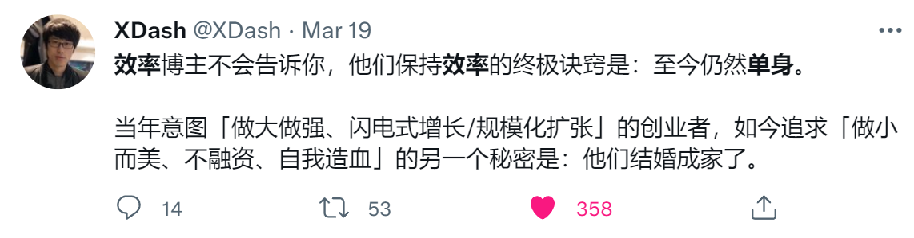

哈喽，

见信好呀，各位！这是酒馆来信的第二期。

本期，我们聊一聊：

- 
- 
- 
- 

为了更好地阅读体验，欢迎来[小酒馆分站阅读](/tavern-letters/tavern-letter-002/)~

---

## ⚙️效率与🐕单身齐飞

周内，和一位朋友聊天。他问：*小赵，你平时是怎么学习的*？我说：*没啥，就是单身，时间比较多*。

关于这一点，范冰老师做过更加精辟的总结：*效率博主不会告诉你，他们保持效率的终极诀窍是：至今仍然单身*。

那么，学习有没有方法呢？答案绝对当然是肯定的，👇是我正在尝试的公开学习。

---

## 🌞公开学习与🌛个人学习

公开学习（Learning in Public，或译“当众学习”）这个概念，我最早在这篇文章中了解到，作者罗列了几点公开学习的好处。而他对公开学习的了解来源以及更系统地介绍这一套理论的，应该是这一系列文章：

1. [Learn In Public](https://www.swyx.io/learn-in-public/)
2. [Learning Gears](https://www.swyx.io/learning-gears)
3. [Pick Up What They Put Down](https://www.swyx.io/puwtpd)
4. [How To Learn In Private](https://www.swyx.io/learn-in-private)

通读下来，第一篇文章反而最**务虚**，没啥嚼头（在后面的文章里，作者也介绍了为什么要这样写：太具体、太务实，就不能因人制宜，而学习可能是很私人定制的事情）。

总结一下，公开学习的概念很像**以教为学**，但是它并不强调教，而是公开。公开的意义在于：

1. **化他律为自律**，以及监督对学习过程、结果的塑造；
2. **持续获得反馈**，以及反馈带来的反思与成长。

写到此处，我意识到，就这两点而言，公开学习比以教为学更好。

1. 以教为学，在个人学习完成之后再进行教学，完成一次学教；公开学习，公开“学习的过程”，“边学边教”，完成多轮学教；
2. 因为过程的公开，公开学习能够获得比以教为学更加高频、及时的反馈。

与公开学习相对的，是个人学习。对比第四篇文章介绍的 Learning in Private（我把它译作个人学习），个人学习与公开学习像是学习这件事的一体两面：个人化的，强调输入；公开化的，强调输出。***输入强化输出，输出反哺输入，构成一个完美的闭环***。

在[How To Learn In Private](https://www.swyx.io/learn-in-private)一文中，作者介绍了一些具体的方法论，比如：

- **个人胜于内容**：当你遇到高度认可的内容，关注它背后的创作者（比如我，赵喧典）。互联网时代，内容会快速过时，或者达到某些商业化目的之后迅速变质，而个人的耐久性更好，能够持续地生产好的内容。

> [!quote] 补充阅读
> 《反脆弱》、《黑天鹅》等书的作者[纳西姆·塔勒布（塔老师）](https://twitter.com/nntaleb)和纳老师都强调了阅读经典的重要性。塔老师说，经典之所谓经典，因为*时间越长，它们的生命力也越长*。

- **了解情境、关注细节**：原文如下，大意是*初学者需要快速入门，需要简明的教程；专家只需要跟进前沿，对知识体系修修补补、添砖加瓦；而学道中途，需要情境，需要对事物细节的理解。*

> [This is especially relevant if you are Intermediate at whatever you’re doing. Think about it: Beginners need tutorials as they give the shortest path to success, Experts just need to tinker and keep up to date, but Intermediates need context and clear explanation of details.](https://www.swyx.io/learn-in-private#:~:text=Think%20about%20it%3A%20Beginners%20need%20tutorials%20as%20they%20give%20the%20shortest%20path%20to%20success%2C%20Experts%20just%20need%20to%20tinker%20and%20keep%20up%20to%20date%2C%20but%20Intermediates%20need%20context%20and%20clear%20explanation%20of%20details.)

> [!quote] 补充阅读
> 陈丹青老师对于一流、二流、三流的说法如下。结合此处的观点，“经由二流去一流的路”断了，可能是因为对情景、细节的忽略。
>
> > 我们遵从一流，忽略二流，最终恰好是困居三流，因为，经由二流去一流的路，断了。 ——陈丹青，[《局部》](https://www.dedao.cn/ebook/detail?id=EJmMZXq1b8qOpBlD69XAdP7LEGaKJWEnDn3xRnme5vrVzo4QMZYgNyk2jNA5467K)

以上四篇文章，最推荐关于个人学习的 [How To Learn In Private](https://www.swyx.io/learn-in-private)，或者你可以先看看我的阅读理解。

---

## 🎑今晚月色真美

周三，在[《蔡钰·商业参考》](https://www.dedao.cn/course/article?id=aYB83z6N9dqxVyP3xjK7ZMvy0GQDO5)听到日本人不会直接说“我爱你”，而是说成“***今晚月色真美***”，会心一笑（记下了😄）。

传说，夏目漱石还是英语老师的时候，曾问学生，“I love you”该如何翻译。有学生翻译为直白的“愛しています”（我爱你）。夏目漱石说，日本人是不会把“我爱你”挂在嘴边的。日本人会说“月が綺麗ですね”（月色真美）。[^1]

网上还流传着来自《源氏物语》的这段话：

> 今晚的月亮真美，也曾和你如今日一般看过月亮，每每想起你我昔日共渡的悲欢时光，就会莫名为光阴的流逝而落泪感伤，从今而后，和你的一切，都会成为慰藉我一生的美好回忆，在我剩下的岁月里，我都会怀念今晚和你一起看过的月亮。[^2]

我在《源氏物语》书中并没有检索到 ，却想起了[《言叶之庭》](https://www.bilibili.com/bangumi/play/ss2546)里的这两段应和：

> 隐约雷鸣，阴霾天空，但盼风雨来，能留你在此。
>
> 隐约雷鸣，阴霾天空，即使天无雨，我亦留此地。

当我和朋友说“单身，时间比较多”的时候，也盼风雨来。

---

## 近者悦♥，远者来👋

本周听了两期孟岩老师的播客。

在[E14 孟岩对话爱哲：我们都有自己的故事 - 无人知晓](https://www.xiaoyuzhoufm.com/episode/62b804912af904c4f0031586?s=eyJ1IjoiNjA3NzZjMjFlMGY1ZTcyM2JiY2I1MjM0In0%3D)中，听到孟岩老师提到往期播客。“*让更多人知道你，还是让爱你的人更爱你*”，这个问题深深打动了我，于是又去听了[E09 孟岩对话黄海：让更多人知道你，还是让爱你的人更爱你 - 无人知晓](https://www.xiaoyuzhoufm.com/episode/61dbf5b519e8465da2f8f4fd?s=eyJ1IjoiNjA3NzZjMjFlMGY1ZTcyM2JiY2I1MjM0In0%3D)。

> [!question] 让更多人知道你，还是让爱你的人更爱你？

在我看来，这是一个选择的问题，更是一个先后的问题。

《论语》说***近者悦，远者来***，是对这个问题的完美回答。

我最早在[跟华杉学儒家思想](https://www.dedao.cn/course/detail?id=z1DWOMARavZVxoMs3LKP2mlx7bjydL)中听到“悦近来远”。华杉老师如是说：

- *只在近处下功夫，只投入在近处的人身上*，远方的人，让他自己来。**悦近，是我的事；来远，来不来是他的事**。
- 要想实现近悦远来，你还需要拥有一种品质，就是**不贪心**。儒家还有一个词叫“**不外慕**”，*只珍惜自己已有的，绝不羡慕外面的*。不管他多好，跟我没关系，他来了才跟我有关系。

所以，先后顺序应该是：***让爱你的人更爱你，然后更多的人会知道你***。

两位老师持同样的观点。他们的对话更生动、更具体，并列举了许多实例 ，推荐收听🎧

## 我的一周

- 将之前分享的论文笔记迁移到了小酒馆 0103 - 丹方，原来有接近 100 篇呢，读书时候的自己真高产呐😁
- 和祝大哥（凯文老师）约好一起参加今年的杭马，开始了体能训练
- 订阅了 #Λ-Reading 推荐的一个 #日历 *One Question A Day（每天一个问题）*：<webcal://addevent.com/feed/euaiehiw.ics>

今天的问题是：What upsets you about other people’s actions — and what does that say about you? （是什么让你对别人的行为感到不满ーー这说明了你的什么问题？（由[彩云小译](https://fanyi.caiyunapp.com/#/)翻译））

如果你觉得本期内容还不错，欢迎订阅、关注。

你有什么想法，请回信告诉我（[kissgletter@outlook.com](mailto:kissgletter@outlook.com)）。与子同 Yue，关于我，也关于你。

---

祝各位阅读愉快、周末愉快
赵喧典 于 🏮 观照酒馆(notes.lifelonglove.cn)
2022-07-02 09:02

[^1]: 今晚月色真美是什么意思？ - 小鸡词典
[^2]: [日语中“今晚的月色真美”是什么梗 - 知乎](https://zhuanlan.zhihu.com/p/142294219)
