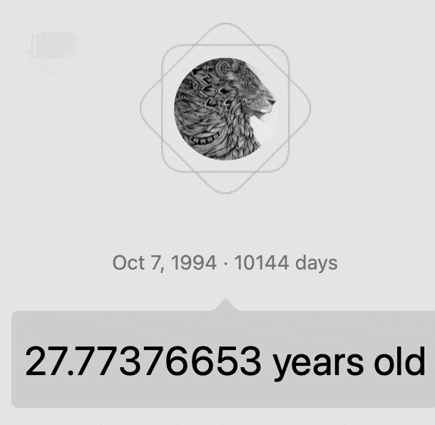
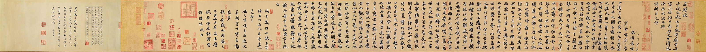
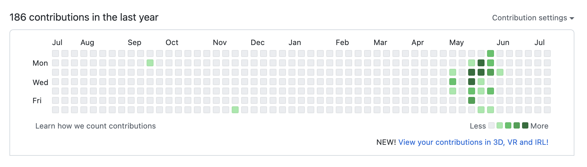

Hello，

欢迎收看酒馆来信第四期：***让万物穿过自己，让时间停驻***。

这是我第一次没有在周四、周五提前整理想要与各位分享的，因为太忙了，忙到——两周半前约朋友吃饭，当他有事情改约的时候，我有一种庆幸😩

所以，先祝各位周末愉快啦！

本期，是一场没有计划的写作，受启发于孟岩老师的一期播客名称：[**让万物穿过自己**](https://www.xiaoyuzhoufm.com/episode/61ee26c84675a08411f51570?s=eyJ1IjoiNjA3NzZjMjFlMGY1ZTcyM2JiY2I1MjM0In0%3D)。

---

## 三十与十五六

我在虚岁与周岁一文中分享了一个有趣的区分法：

- **虚岁**，记录的是生下来经历过的年数，它将人嵌入到了时间、历法之中；
- **周岁**，则是把时间往人身上套，它是人经历过完整的一整年之后的累计的周年数。

这是两套完全不同的计数逻辑。按照虚岁计，明年我就三十了；按照周岁计，现在我才27！

我下班的时间，恰好是附近一所中学晚自习下课的时间。许多学生骑自行车🚴回家，我也是。当我骑着车🚴，混迹在他们中间。晚风吹他们也吹过我，让我有点恍惚：*我与他们没有区别，也是十五六岁，时间并没有穿过我*。

## 周岁人生

近年来，兴起了一股“**从自己出发**”的世界观，比如项飙老师的这本书《把自己作为方法》、孟岩老师这期播客：[**让万物穿过自己**](https://www.xiaoyuzhoufm.com/episode/61ee26c84675a08411f51570?s=eyJ1IjoiNjA3NzZjMjFlMGY1ZTcyM2JiY2I1MjM0In0%3D)。

在播客的尾声，孟岩老师讲到：

> 我们每个人可能都不知道会发生什么。但是我愿意放手，我也愿意纵身一跃，我愿意去冒险，我愿意去相信我自己的身体，然后相信自己的心，然后我愿意去在场，我愿意去体验，我愿意去经历，我愿意去把自己变得更加的丰盈、专注、放松。最后就是允许万事万物穿过自己，然后穿过我内心的那些毁掉不断重建的那些房子，最终让他们都穿过自己。

孟岩老师用了很多“我愿意”，他告诉我们：要*去经历、去体验、去置身事内、去获得[身临其境的实感](/tavern-letters/tavern-letter-001/#一期播客-一个普通人可以拥有怎样的生活-螺丝在拧紧)*。这里的主体都是，我、 我、我。

***时间是万物的尺度***。从时间出发，它穿过我，无可阻挡地把我从27送往28。

从我出发，***我是我所经历的万事万物的尺度***。我选择*让万物穿过自己，让时间停驻*。

对此，千年前，苏子有过更加精彩的议论：

> 逝者如斯，而未尝往也；盈虚者如彼，而卒莫消长也。盖将自其变者而观之，则天地曾不能以一瞬；自其不变者而观之，则物与我皆无尽也。——《前赤壁赋》

自其变者，持“时间是万物的尺度”观点；自其不变者，则是“我是我所经历的万事万物的尺度”的另一种表达。

物（时间）与我的两套世界观，恰如虚岁与周岁的逻辑。许多年后，我的墓碑🪦上写着“赵喧典，1994-YYYY”，但是这段时间真能够定义我平凡的一生吗？**不能够啊**！相比之下，我每周与你分享的这一期期酒馆来信、我写下的这些文字，更能够表达我的一生。像[上一期“诗酒趁年华”](/tavern-letters/tavern-letter-003/#写作)中，年轻作家说的，写作要趁早，因为这也是我今生今世的证据之一。

与***虚岁人生***——人嵌入到时间之中，我更愿意去过一场***周岁人生***——让时间上身、让我所经历的万事万物定义我的一生。

人生，有两个进度条。我们无可避免地同时在过虚岁人生与周岁人生，我们能做的就是尽量去提高周岁人生占虚岁人生的比例。

我想到一个很好的比喻：***人生热力图***！人生本是一场灰白，我们每天的一个行动，都是在那一格灰白的格子上增添一抹亮色。我好喜欢这里 contribution 的定义：原语境（Github Heatmap）下，每一次 commit（提交）都是对项目的一次贡献；对人生，每一个行动，都是对我们自己人生的一次贡献——用行动创造人生。

## 我的一周与推荐

- 过去的一周很有压力，一直在忙着工作，从醒来到睡去
    - 这个习惯不好，但是我还没找到解
- 分享了 leader 的建议
- 我原计划昨天（周五）去跑一次步，但是午休醒来，身体倍感不适，有一种强烈的恐惧——要是坚持跑步，可能就要上新闻了😂
    - 因此，对于“我们更加需要的是休息，而不是运动”有了直观的体会
- 买了一台 M1 Pro Macbook Pro，这封酒馆来信就是在新本本上开心地完成的

    - 我想着，有了它以后，提高了办公效率之后，我要把更多的时间留给生活
    - 我也意识到，这可能是一个对自己美丽的谎言——我将用它来更愉快地干更多的活

- 最后分享一段很喜欢的话：

> 我曾经问过自己一个问题：最羡慕谁的人生？最好的回答当然是“既然我已经和自己周旋很久了，那就还是做我自己吧”——贾行家

---

祝各位阅读愉快
赵喧典 于 🏮 观照酒馆(notes.lifelonglove.cn)
2022-07-16 10:07
