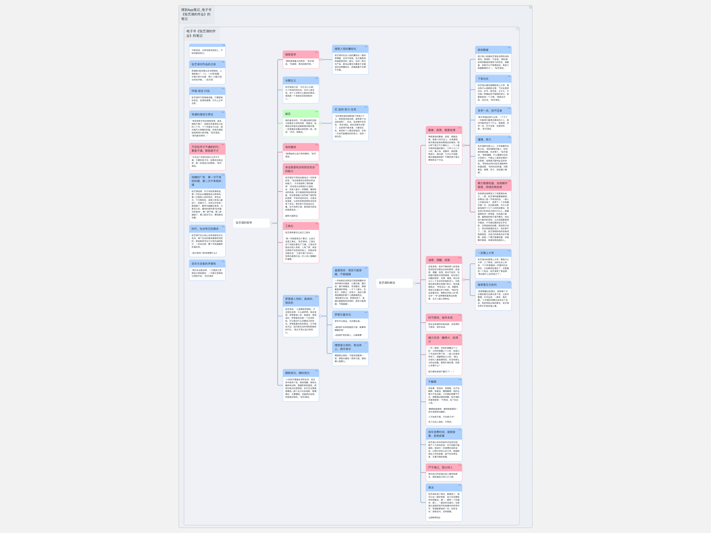
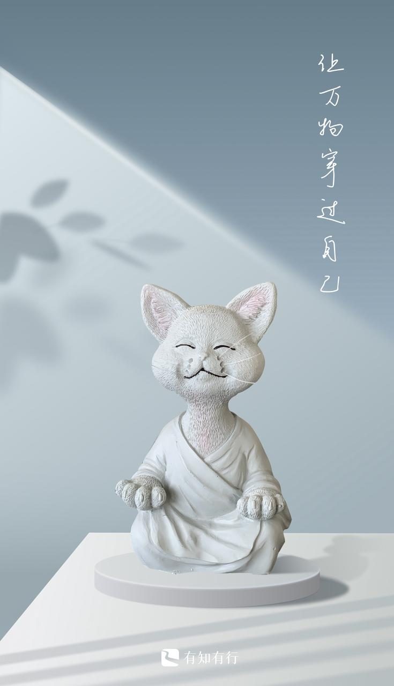

Hello~，

周末好呀，朋友们！欢迎收看酒馆来信第 七 期：张艺谋的作业与留下的哲学。

酒馆来信写得漫无目的，但其实有一个隐性的核心：**我希望分享更恒久的内容**。一来，看过的朋友能够有所收获，留下点什么（留下的哲学😄）；二来，新老朋友都可以不断往前考古，而往期分享也不负所望。

---

## 张艺谋的作业

偶然又看到了这本书[《张艺谋的作业》](https://book.douban.com/subject/7064581/)，想推荐给各位。

想来大家都知道[张艺谋](https://baike.baidu.com/item/%E5%BC%A0%E8%89%BA%E8%B0%8B/147018)、喜欢他的作品，但是可能并不了解老谋子其人。

这本书，让我更了解了老谋子，为他所折服，从此路转粉。它出版于 2012 年，是一本 10 年前的老书了，基于访谈写成的“张艺谋的作业”。老谋子在访谈中表现出的气质，作者都写在文字中了。读此书，我感受到老谋子的那种：***勤奋、刻苦、自律、诚恳、清醒、坦荡***。

[这张思维导图](assets/836dbc952e12-张艺谋的作业_赵喧典.pdf)是我个人总结的老谋子的哲学与做法。以老谋子为榜样，与君共勉！（文字链接是 PDF 版）

引用两段很触动我的话，让不方便打开思维导图的朋友也领略一下老谋子的魅力。

> [!quote] 张艺谋有意识让自己工具化
> “我一开始就有这个意识，让自己迅速工具化。”张艺谋说。工具化这个词他反复说了几遍。*工具化你就会对别人有用，人有了用，有些东西就不会找到你身上，你就会有空隙生存*。“工具不是个坏词儿，有用也是我们这一代人深入骨髓的价值感。”

这段话让我对“工具人”有所改观：从有用的角度来看，何妨让自己工具化？谁又不是呢？

补充分享：动画短片[雇佣人生 - 哔哩哔哩](https://www.bilibili.com/video/BV15s411k7Jx/)

> [!quote] 梦想是入世的、具体的、现实的
> 张艺谋说：“人是要有梦想的，不过我也在想，什么是梦想。我总觉得，梦想是很入世、很具体、很现实的，*梦想是你在某一个生存阶段，可以做点什么改善自己的状况，梦想是最切实的想法，它不能在天边，因为那无法作用和影响你的行为*。”他从不承认自己有机心。

---

## 留下的哲学

周四，🚴骑车上班路上，等红绿灯，突然想起“*教育是离开学校之后留下的*”这个说法。

去检索出处，发现原来是爱因斯坦说的：

> Education is what remains after one has forgotten everything he learned in school. — **Albert Einstein**.

罗老师在他的新书[《阅读的方法》](https://book.douban.com/subject/35870746/) 中把对象换成了读书，表达了相似的观点：

> 我们读过的书，大部分都会遗忘。但如果我们在书中遇到喜欢的人、尊敬的人、有趣的人，他们做事的方式就会留下来，变成清晰的烙印，深刻地影响着我们。——《阅读的方法》 罗振宇

我又双叒叕想起了孟岩老师的这一期播客：[让万物穿过自己](https://www.xiaoyuzhoufm.com/episode/61ee26c84675a08411f51570)。在[酒馆来信第四期](/tavern-letters/tavern-letter-004/#周岁人生)中，我分享了“让万物穿过自己”去经历的一面。

现在看来，***经历是一方面，留下的经验是另一方面***。让我们变得更加丰盈的，归根结底是留下的。

我还收藏了类似观点的一句话🧐： *旅行不是为了看到不同的事物，而是为了学会不同地看待事物 (You don't travel to see different things, you travel to see things differently.)*。

我更愿意是这样的：***旅行是为了看到不同的事物，也是为了看过不同事物之后，学会不同地看待事物***。

人生像一只空杯，装进去一些又倒掉一下。这反复的过程，就是我们精彩的一生，而这只杯子以及它留下的、承载的就是我们自己。

让万物穿过自己，让自己更加丰盈。

---

如果你喜欢酒馆来信，欢迎转发给更多的朋友（Quaily 订阅：[酒馆来信](https://quaily.com/lifelonglove)），也欢迎回信交流：[kissgletter@outlook.com](mailto:kissgletter@outlook.com)。

祝各位更加丰盈
赵喧典 于 🏮 观照酒馆(notes.lifelonglove.cn)
2022-08-06 09:13
