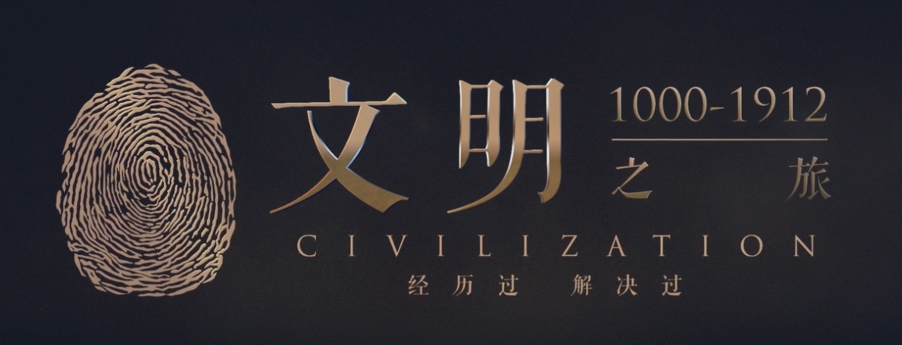
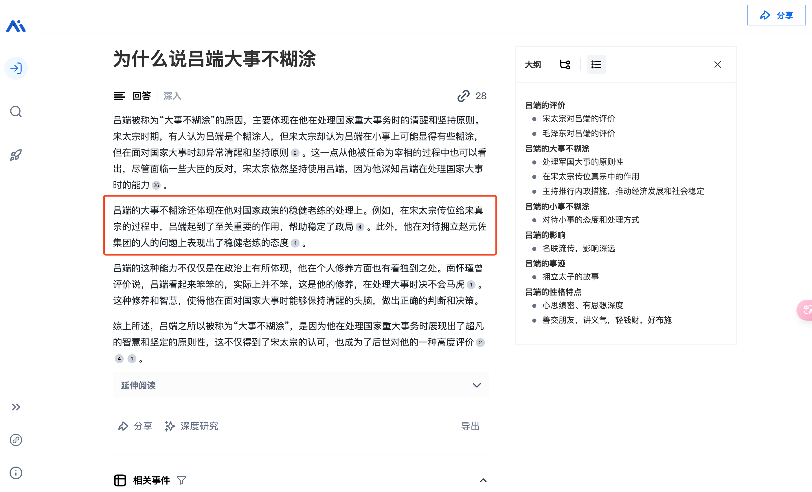
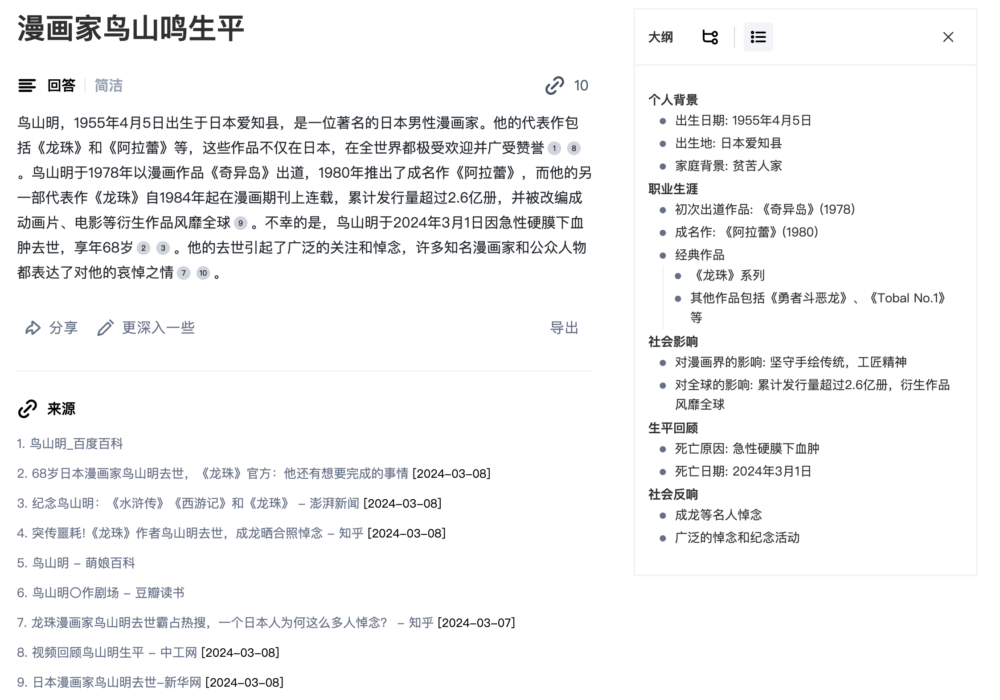

Hello~

好久不见, 朋友们! 欢迎收看酒馆来信第 八 期.

自从 2022 年 8 月 6 日[第七期的酒馆来信](/tavern-letters/tavern-letter-007/)之后, 断更已有 1 年 07 个月 4 天.

在[酒馆来信 002](/tavern-letters/tavern-letter-002/)期中, 有一小节叫[⚙️效率与🐕单身齐飞](/tavern-letters/tavern-letter-002/#效率与-单身齐飞), 断更证明是真的: 那段时间, 我开始恋爱了 🫣.

过去的一年半时间, 我度过了 30 虚岁, 成家了, 换了工作, 目前努力立业中~ Fighting 🆙

---

# 有启发

> [公元1000年：宋代如何走出五代阴影？](https://www.dedao.cn/share/course/article?id=Lpy0edZAG5mnK0wlo1XzD9BkoajY4x&trace=eyJzX3BpZCI6IjEwODE0NyIsInNfcHR5cGUiOiI2NSIsInNfdWlkIjozMzI1Njc4NH0%3D)

这是罗老师<文明之旅>的第一期. 从宰相吕端之死说起, 讲到"宋太宗驾崩, 吕端如何阻止太后另立新君", 讲到五代宋初的皇帝继承问题.

视频中提到: 五代历53年，有过14位皇帝. **政权和皇位更替太频繁了**!

至于大宋, 太宗赵匡义是太祖赵匡胤的弟弟, 皇位是**兄终弟及**的. 太宗在位时, 后来的真宗已经被立为太子了. 然而, 当太宗驾崩 (公元 997 年), 在有储君的情况下, 太后欲**废幼立长, 另立新君**. 这, 就是五代的阴影.

从后世看, 宋是五代之后的统一王朝, 北宋历 167 年 (公元 960-1127年), 南宋历 152 年 (公元1127-1129 年), 两宋共 319 年. 但是, **从当世的视角看, 997 年, 赵宋才历两任皇帝, 承平才 38 年, 之前是近百年的唐末乱世**. 凭什么他赵家不会重蹈五代的覆辙, 成为"梁唐晋汉周宋"中的第六代呢?

所以太宗太后要立更年长的皇子为皇帝, 为了皇权与国家的稳定. 这符合乱世的皇权交接逻辑, 不无道理. 吕端保太子登基, 则是因为太子地位的合法性: 要保证国家的**长期稳定**, 太子地位不可动摇.

以上, 比起吕端的"大事不糊涂", 带给我更多启发的, 反而是太宗太后为什么糊涂了. 从后世的命名看, 五代十国与大宋有着明显的分别; 但是作为当世人, 尤其是亲历者, 情况是完全不一样的, 大宋会是梁唐晋汉周之后的第六代吗?

# 读书摘记

> [!note Leandro von Werra 从事 BigCodeProject 一年多的经验之谈]
> **Small, aligned teams can build great things fast. 小而团结的团队可以快速构建伟大的东西**。([Leandro von Werra 从事 BigCodeProject 的经验之谈](https://twitter.com/lvwerra/status/1764710833626436017))

> [!note <繁花>]
> 康总说，名堂不少。梅瑞说，也许，这朋友，全部是乱讲。康总不响。梅瑞说，*人讲的故事，往往是表面文章*，懂了吧。

> [!note <营销笔记>]
> 有一次我去重庆见一个客户，客户问了我一个问题：“为什么重庆的火锅这么好吃，却没有特别火的全国性品牌？”我说，*其实只是重庆人觉得重庆火锅好吃*，作为一个山东人，我觉得重庆火锅又油又腻、又麻又辣，我真的没办法接受这种重口味。

# 好物推荐

1. [秘塔AI搜索](https://metaso.cn/search/8455144233900060672): AI 新时代的搜索引擎, 能够根据用户输入的问题, 检索相关网页, 自动组织内容, 并由 AI 生成答案.
    - 比起谷歌百度类搜索引擎, 可直达答案, 省去了人工再通过浏览网页寻找答案的过程; 因为是 AI 自动生成的答案, 需要辨别.
    - [秘塔AI搜索- 为什么说吕端大事不糊涂](https://metaso.cn/s/MV9PRg)
    - [秘塔AI搜索- 鸟山明的生平](https://metaso.cn/s/a4BHGF)

---

如果你喜欢酒馆来信，欢迎转发给更多的朋友（Quaily 订阅：[酒馆来信](https://quaily.com/lifelonglove)），也欢迎回信交流：[kissgletter@outlook.com](mailto:kissgletter@outlook.com)。

祝各位阅读愉快

赵喧典 于 🏮 观照酒馆(notes.lifelonglove.cn)

Mar 10, 2024 at 20:54
